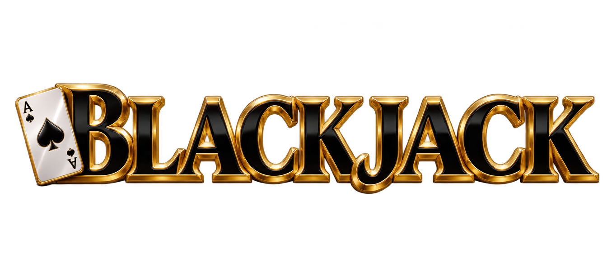
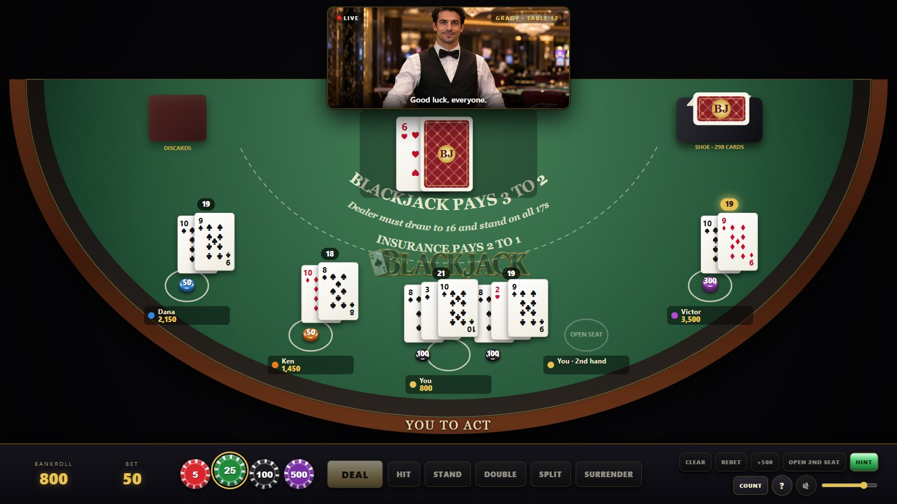
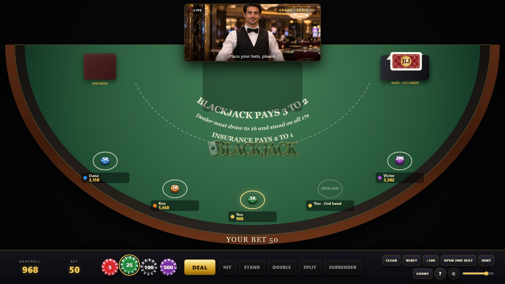
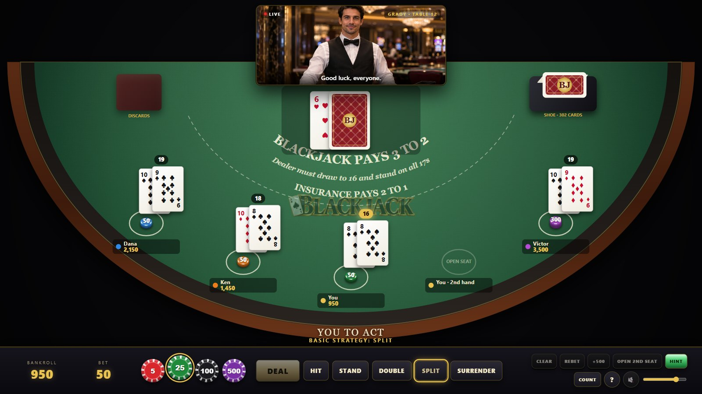
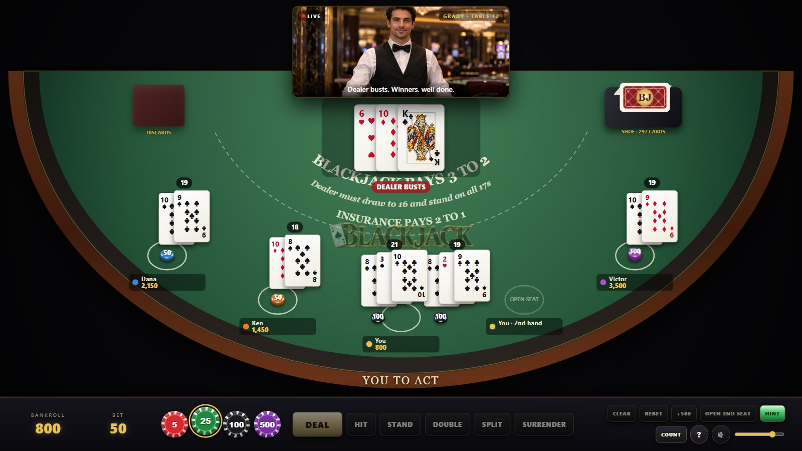
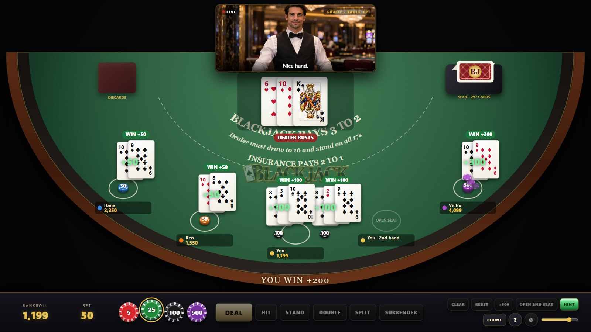
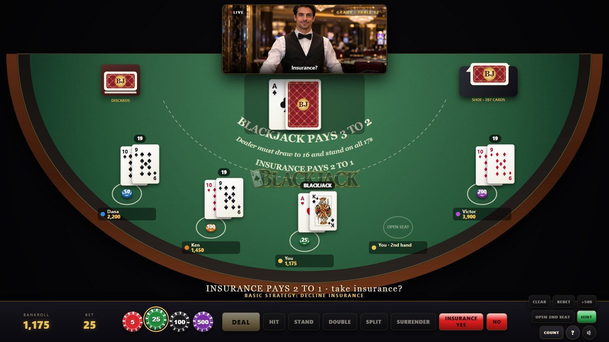
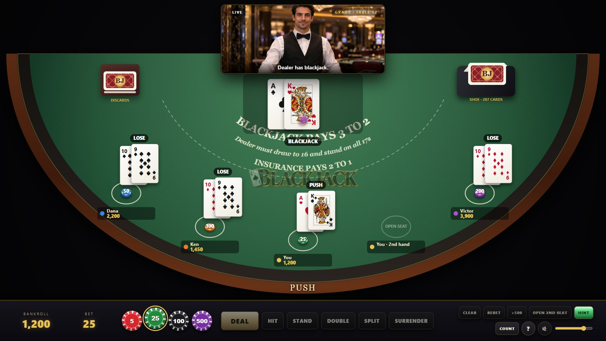
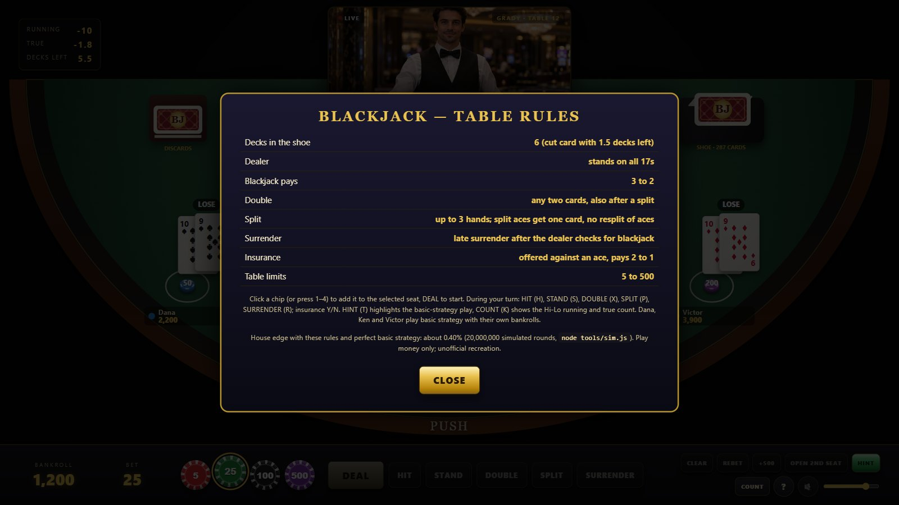

<div align="center">



### A photoreal six-deck Vegas Strip blackjack table with a live-style dealer, basic-strategy regulars, hints and a Hi-Lo count


-0.40%25-d4af37)




</div>

Plain HTML5 Canvas, Web Audio and vanilla JavaScript. No frameworks, no build
step, no server-side code. The same rule code that runs the table plays twenty
million rounds of basic strategy in `tools/sim.js` and reports the house edge,
and 49 unit tests pin down totals, splits, doubles, surrender and payouts.

> Unofficial recreation for entertainment only. Play money, no real wagering.

---

## Contents

1. [Features](#features)
2. [Platforms](#platforms)
3. [Installation](#installation)
4. [Configuration reference](#configuration-reference)
5. [User guide](#user-guide)
6. [Keyboard shortcuts](#keyboard-shortcuts)
7. [Known limitations](#known-limitations)
8. [Project layout](#project-layout)
9. [Development](#development)

---

## Features

**Rules (Las Vegas Strip)**

* Six-deck shoe with a cut card (1–8 decks configurable), dealer **stands on soft 17**
  (hit-17 configurable), dealer peeks for blackjack under an ace or a ten
* Blackjack pays **3 to 2**; a blackjack against a dealer blackjack pushes; 21 after a
  split is not a blackjack
* Double on any two cards, **double after split**, split up to **three hands**, split
  aces receive one card and cannot be resplit, **late surrender**, **insurance** 2 to 1
* Bets 5–500 with 5 / 25 / 100 / 500 chips; open a second seat to play two hands

**The table**

* Three regulars — Dana, Ken and Victor — bet with their own bankrolls and play
  basic strategy (they take insurance only when the true count is +3 or more)
* A live-stream style dealer panel with a photoreal dealer who speaks: *place your
  bets*, *no more bets*, *insurance?*, *blackjack!*, *dealer has nineteen*, *dealer
  busts*, *push*, *shuffling*…
* **HINT** highlights the basic-strategy play for the current hand (full 6-deck
  S17/H17 DAS late-surrender chart); **COUNT** shows the Hi-Lo running count, true
  count and decks remaining

**Verified maths (`node tools/sim.js 20000000`, 20,000,000 rounds each, ± 0.03 %)**

| Rules | House edge |
| --- | --- |
| 6 decks, S17, DAS, late surrender, split to 3 hands, no RSA (default) | **0.40 %** |
| same without surrender (`--no-surrender`) | 0.47 % |
| same with the dealer hitting soft 17 (`--h17`) | 0.58 % |

Player blackjack 4.73 %, dealer blackjack 4.74 %, hands won 42.6 % / lost 49.1 % /
pushed 8.3 %, doubles 10.2 % of hands, split hands 5.1 %, surrenders 4.4 %. The
browser engine itself, driven headless through 4,104 flat-bet hands
(`node tools/edge-check.mjs`), returned −0.19 % ± 1.8 %.

**Presentation and sound**

* Crisp vector cards (indices, pips) with generated court figures on J / Q / K; a
  patterned card back; cards slide out of the shoe, flip with perspective, and go
  to the discard tray; chip stacks on the circles, payout flights and labels
* Mahogany rail, padded armrest, printed felt (3 to 2, insurance line, rules),
  card room backdrop
* Everything synthesized in Web Audio — card slides, snaps and flips, the shoe,
  shuffles, chip clinks, win chimes, bust thuds, a soft card-room murmur — plus
  nineteen generated dealer voice lines

---

## Platforms

| Platform | Status | Notes |
| --- | --- | --- |
| Chrome / Edge (desktop) | Tested | Headless Chrome runs the smoke test and screenshots |
| Firefox (desktop) | Expected to work | Standard Canvas 2D and Web Audio |
| Safari (macOS / iOS) | Expected to work | Audio starts after the first tap |
| Android / iOS browsers | Playable | Scene scales to the screen; landscape recommended |
| Offline / `file://` | Works | Voice clips need HTTP; captions still show |

Requirements: a browser with Canvas 2D, Web Audio and ES2020. Node.js 22+ only for
the optional tools.

---

## Installation

1. **Get the files.** Keep `assets/`, `css/` and `js/` next to `index.html`.
2. **Serve it (recommended):**

   ```bash
   python -m http.server 8767
   ```

   or double-click `start.cmd` on Windows, then open <http://localhost:8767/>.
3. **Or open `index.html` directly** from disk (Chrome, Edge).
4. **Click once** on the splash to unlock audio. You sit at the centre seat with
   1,000 play chips; **+500** buys in more.
5. Optional URL parameters: `?mute=1` silent, `?fast=1` quick animations,
   `?h17=1` dealer hits soft 17.

### Configuration reference

| Setting | File | Default | Meaning |
| --- | --- | --- | --- |
| `decks` | `js/config.js` | `6` | Decks in the shoe (1–8) |
| `penetrationDecks` | `js/config.js` | `1.5` | Cut card: reshuffle when fewer decks remain |
| `hitSoft17` | `js/config.js` | `false` | Dealer hits soft 17 |
| `blackjackPays` | `js/config.js` | `1.5` | 3 to 2 (`1.2` for 6 to 5) |
| `doubleAnyTwo`, `doubleAfterSplit` | `js/config.js` | `true`, `true` | Doubling rules |
| `maxSplitHands`, `resplitAces`, `splitAcesOneCard` | `js/config.js` | `3`, `false`, `true` | Splitting rules |
| `lateSurrender`, `insurance`, `peek` | `js/config.js` | `true`, `true`, `true` | Surrender, insurance, dealer peek |
| `minBet`, `maxBet` | `js/config.js` | `5`, `500` | Table limits |
| `CHIPS` | `js/config.js` | 5 / 25 / 100 / 500 | Chip denominations and colours |
| `SEATS` | `js/config.js` | Dana, Ken, You, 2nd seat, Victor | Names, bankrolls, betting styles |
| `TIMING` | `js/config.js` | deal 0.28 s, think 0.9 s… | Animation pacing |
| `bj.volume`, `bj.muted` | browser `localStorage` | `0.8`, `0` | Remembered volume and mute |

The simulator reads the same `RULES`, so `node tools/sim.js` reports the edge for
whatever you configure (`--h17`, `--decks=N`, `--no-surrender`, `--no-das` override).

---

## User guide

### Betting



Click a chip (or press 1–4) to add it to the lit seat; click the circle of your
second seat to open it. CLEAR takes your chips back, REBET repeats last round's
bets. The regulars place their own bets. Press **DEAL**.

### Playing a hand



Cards come out of the shoe left to right, the dealer's second card face down. If
the dealer shows an ace you are offered insurance; with a ten showing the dealer
peeks. On your turn the available actions light up; **HINT** marks the
basic-strategy play.


Split pairs up to three hands, double after a split, surrender a bad first two
cards for half the bet.

### The dealer's turn and the settlement



The hole card flips and the dealer draws to 16, standing on all 17s, announcing
the total or the bust.



Winning bets are paid (blackjack 3 to 2), pushes returned, losing chips swept;
the cards go to the discard tray and the next round opens. When the cut card is
reached the shoe is reshuffled and the count resets.

### Insurance and dealer blackjack





### Rules and count



**?** opens the table rules; **COUNT** shows the Hi-Lo running count, the true
count and the decks remaining.

---

## Keyboard shortcuts

| Key | Action |
| --- | --- |
| `Space` / `Enter` | Deal (while betting), hit (during your turn) |
| `D` | Deal / double |
| `H` `S` `X` `P` `R` | Hit, stand, double, split, surrender |
| `Y` / `N` | Take / decline insurance |
| `1` `2` `3` `4` | Add a 5 / 25 / 100 / 500 chip |
| `C` / `B` | Clear bet / rebet |
| `T` / `K` | Hint / count panel |
| `?` / `M` / `Esc` | Help / mute / close help |

---

## Known limitations

* One human player (one or two seats); the three regulars are scripted basic-strategy players.
* No side bets (Perfect Pairs, 21+3) and no even-money shortcut: with a blackjack
  against an ace you simply take or decline insurance.
* Bankrolls are play money and are not saved between visits.
* Browsers block sound until the first click; the splash exists for that.
* The dealer panel is a photoreal still with subtle motion plus voice; it is not
  a video avatar.
* Court-card figures are generated art, not a licensed deck design.

---

## Project layout

```
blackjack/
├── index.html            page: canvas, dealer panel, count, control bar, help, splash
├── start.cmd             Windows launcher (local server + browser)
├── css/style.css         HUD styling
├── js/
│   ├── config.js         rules, chips, seats, timings
│   ├── cards.js          shoe, hand totals, Hi-Lo, rule helpers, basic strategy, playSeat
│   ├── audio.js          shared Web Audio synthesizer engine
│   ├── audio-bj.js       table sounds, ambience, voice clip player
│   ├── fx.js             particles / flash (shared engine)
│   ├── renderer.js       table, shoe, tray, seats, vector cards, animations
│   ├── game.js           round engine, insurance/peek, turns, dealer, settlement, voice
│   ├── ui.js             DOM controls, hints, count, help, keyboard
│   └── main.js           bootstrap, frame loop, test hooks
├── assets/
│   ├── cards/*.png       12 court figures (transparent)
│   ├── dealer/dealer.png photoreal dealer portrait
│   ├── bg/room.jpg       card-room backdrop
│   ├── logo.png          title logo
│   └── audio/*.mp3       19 dealer voice lines
├── docs/
│   ├── index.html        GitHub Pages landing page
│   └── screenshots/      images used here and on the landing page
└── tools/
    ├── sim.js            house-edge simulation (basic strategy, game rule code)
    ├── test.js           49 unit tests
    ├── headless.mjs      shared headless-Chrome helper (no dependencies)
    ├── smoke.mjs         end-to-end checks with forced shoes
    ├── stress.mjs        random rounds with chip-conservation checks every round
    ├── edge-check.mjs    the browser engine itself plays flat-bet basic strategy
    ├── screenshots.mjs   documentation screenshots
    └── pngalpha.py       alpha-channel report for PNG assets
```

---

## Development

**Run locally:** `python -m http.server 8767` (or `start.cmd`), open
<http://localhost:8767/>. No build step.

**Maths:** `node tools/sim.js [rounds] [--h17] [--decks=N] [--no-surrender] [--no-das]`
prints the house edge and hand statistics; `node tools/test.js` runs the unit tests.

**Headless tests:** `node tools/smoke.mjs` launches headless Chrome or Edge,
forces specific shoes (`BJ.game.forced = ['A','K', …]`) and asserts a blackjack
payout, split-and-double, insurance against a dealer blackjack, surrender, the
reshuffle, a second seat and a run of random rounds, failing on any page error.
`node tools/stress.mjs [rounds]` plays random rounds on two human seats (insurance
taken every other offer) and checks after every round that each seat's chips are
conserved: bankroll after the settlement = bankroll + bets before the deal + the
sum of the hand results. `node tools/edge-check.mjs [rounds]` lets the browser
engine itself (not the simulator) play flat-bet basic strategy and prints the
player return, outcome frequencies and the rank distribution dealt; 2,000 rounds
on two seats (4,104 hands) returned −0.19 % ± 1.8 %, consistent with the
simulator's −0.40 %. `node tools/screenshots.mjs` regenerates `docs/screenshots/`.

**Console hooks:** `BJ.step(seconds)` advances the virtual clock; `BJ.game`,
`BJ.cards.basic(...)` and `BJ.audio` are exposed.

**Publish:** enable GitHub Pages for the repository root; the game is served at
`/` and the landing page at `/docs/`.
